# The studio side: workflow audit and benchmark — October 2026

**For:** Eric, to decide. **Status:** proposal. Nothing here has been built or changed.
**Measured on:** `main` at dfcf28d, with the e2e fixtures (`tests/e2e/helpers/app.ts`, `installApp`) plus an agency persona built from `buildNav` (`audit/studio/walks/fixtures.ts`), desktop Chromium at 1280×800. The walks use the real menu an agency owner gets at studio level, and the real context bar when drilled into a client.
**Not included:** the open PRs #27 (experience review), #29 (one link from proposal to deposit) and #31 (the moment after paying). Where one of them changes a finding, the finding says so.

[WORKFLOW-AUDIT-2026-10.md](WORKFLOW-AUDIT-2026-10.md) walked the business owner's workspace and the client's portal. [BENCHMARK-2026-10.md](BENCHMARK-2026-10.md) held both against the market. Both only *listed* the studio side. This document is the third of the set and covers what they left out: **the agency owner's own seat** — the screens and jobs Eric touches as the studio, not as a business owner and not as a client. The market research behind section 5 is in [research/studio-benchmark-2026-10.md](research/studio-benchmark-2026-10.md) (266 sources).

## The short version

- **The studio has two homes and two rosters.** `agency.html` (the landing page: queues and the client portfolio) and `today.html` (still in the agency's menu: the studio's own money, this week, key deals) are both "home". `agency.html` and `customers.html` are both "your clients", read from two different tables, with different columns and different row actions. "Switch client" in the context bar goes to the *other* roster.
- **Acting for a client works, and is audited, but the product speaks as if the client were doing it.** Drilled into a client, every request carries the scope, the server validates it and logs it, and the operator can publish, connect and invite. But the publish ritual says "your site" and "every word came from you", the client's room records the publish as "published by you", and the Google connect page says "Who owns it: you do."
- **Two pages drop the client scope silently, and one of them invites the wrong tenant.** Sharing & access never sends the scope header: with "Viewing client Marlow's Kitchen" on screen, *Send invite* invites the reviewer to **the studio's own site**. Settings shows a "Studio profile" form that reads and writes the *client's* identity, while four of its cards jump out of the client without saying so.
- **Onboarding a new client is one dialog and five clicks, and it does more than any competitor.** It creates the workspace, a hosted site, a delivery project, the portal link and the invitation in one go. Nothing on the agency's own home page offers it, ⌘K finds nothing for "client", "add client" or "invite", and the success copy promises a "guided setup" the link does not lead to.
- **Selling is seven clicks and three emails; delivery is five clicks and one email.** Proposal, agreement and deposit each go out separately (PR #29 folds them into one link). A deal's Billing tab shows five filled buttons at once. Asking a client to approve is quick, but always at project level, and nobody is reminded.
- **Seven things exist on the server with no door in the product:** team invites with eight roles, client tags, notes, assignment and archive, agency branding, usage and the portfolio's search and archive filters. The only way to add a team seat today is an operator-only route no page calls.
- **Twelve changes are ranked at the end**, each with an effort size. The first two are small and fix wrong-tenant writes. Together the top six would give the studio one home, one roster, a product that speaks as the studio, and a team.

---

## 1. Every studio-side page and menu destination

"Reached from" means where the studio finds the page: **Nav** is the primary bar `buildNav` gives an agency member at studio level; **Overflow** is the account menu; **Context bar** is the "Viewing client" card that appears once drilled into a client (`shell.js` `mountContextBar`); **Links** are links from other pages.

The agency's primary bar at studio level: **Today · Customers ▾ (Customers, Contacts, Broadcasts) · Pipeline · Projects · Inbox · Files ▾ (Files, Visual Studio) · Analytics · Studio** — 9 groups, 12 destinations. The overflow: **Your website ▾ (Website, Business info, Design, Add a page, Domain & email, Publish, History) · Connections · Settings ▾ (Settings, Sharing & access, Developer Mode) · Help** — 12 destinations. **24 in all**, plus the context bar's five links when scoped (Open record, Their Today, Their website, Switch client, Exit to Studio).

### The studio's own pages

| Page | What it is for | Reached from | Same data also on |
| --- | --- | --- | --- |
| `agency.html` | "Studio": the agency's landing page. *What needs you today* (cross-client queues), the client portfolio (table or cards: name, edition, status, waiting, leads, domain and expiry; chips All · Needs attention · Domain expiring · Billing · All clear), starter kits, and a *Platform health* link for staff | Nav **Studio**; landing for every agency account; "Exit to Studio"; profile menu | `customers.html` (the other roster), `analytics.html` (the portfolio lens reads the same `/agency/portfolio`), `today.html?client=` (the queues' rows) |
| `customers.html` | The studio's customer roster: name, email, status, support, projects; **+ Add a customer** (the onboarding dialog) | Nav **Customers**; "Switch client" in the context bar | `agency.html` (`/agency/portfolio` vs `/studio/customers`), `contacts.html` (carries the same dialog) |
| `pipeline.html` | The studio's deals. All deals live on the agency's own site, so this is the cross-client pipeline. Deal detail (full page): stage path, Overview · Billing · Activity; proposals, agreements, invoices, deposits, schedules, retainers, convert | Nav **Pipeline**; records; Today's key deals | `crm.html` (the record's Deal and Billing tabs read the same deal), `today.html` (money band) |
| `projects.html` | The studio's delivery projects (also all on the agency's site): tasks, milestones, deliverables, approvals, surveys, messages, support | Nav **Projects**; records; convert | `crm.html` Project tab (read-only), the client's portal |
| `crm.html` | One customer's record: Details · Deal · Billing · Project · Files, an activity rail and a composer | Rosters' "Open record"; context bar; pipeline; Inbox; ⌘K record search; never in the nav | pipeline (deal), projects (project), inbox (messages) |
| `inbox.html` | One queue across every customer of the studio: messages, support, enquiries, approvals, notices; client and project filters | Nav **Inbox**; bell | `today.html` Needs you, `crm.html` rail |
| `today.html` (studio level) | The studio's own Today: money band (who owes you), this week, coming up, key deals, waiting on clients | Nav **Today** (still shown to agencies); brand mark | `agency.html` (home), `pipeline.html` (tiles), `analytics.html` |
| `analytics.html` (portfolio lens) | For an unscoped agency member: Clients · Needs attention · Enquiries waiting · Sites live, "what stands out", and a client-by-client table (plan, waiting, enquiries, visitors) | Nav **Analytics** | `agency.html` (same portfolio rows; no money on either) |
| `contacts.html`, `broadcasts.html`, `files.html`, `visual-studio.html`, `help.html`, `developer.html` | As the owner workspace uses them. Note: `contacts.html` carries a copy of *Add a customer* and *does* send the scope header; `broadcasts.html` has no customers-only audience | Nav / overflow | — |

### Operating a client (drilled in with `?client=`)

| Page | What it is for | Reached from | Same data also on |
| --- | --- | --- | --- |
| `presence.html?client=` | The client's website builder, exactly as the client sees it, under a "Viewing client" card and a "Studio › name" breadcrumb; Website becomes primary again | Rosters' **Their website**; context bar | the client's own builder |
| `today.html?client=` | The client's Today | Queue rows on `agency.html`; context bar **Their Today** | the client's own Today |
| `connections.html?client=` | Connect Google Search Console or Analytics *for* the client; the OAuth return carries the scope through `localStorage` | Overflow **Connections** while scoped | — |
| `settings.html?client=`, `sharing.html?client=`, `inbox.html?client=` and every page in `APP_PAGES` | The same pages with the scope in the URL. Whether the *requests* carry it varies by page (see bugs 1–3) | Overflow / nav while scoped | — |

### Operator and admin

| Page | What it is for | Reached from | Same data also on |
| --- | --- | --- | --- |
| `admin-health.html` | Health Center: ten areas (platform, cron, domains, billing, AI, email, usage, errors, alerts, backups) in bands, with KPI tiles and drill links | A text link at the foot of `agency.html` (staff only); Settings' **Domains & email** card (every website user) | — (unique) |
| `admin-growth.html` | Growth: partnerships and monthly reviews on the legacy `clever-api`, with its **own** sign-in and session | `admin-health.html` only | — |
| `provision.html` | Partner provisioning generator (offline; no auth, no shell) | Nothing links to it | — |
| `studio.html` | The owner and team door | — | — |

**Count:** 23 pages a studio account touches (including the four it shares with the owner workspace unchanged), of which 3 are operator-only and 1 (`provision.html`) is unlinked. 24 menu destinations. Of those, **three pairs show the same thing twice**: Studio and Today (two homes), Studio and Customers (two rosters), Studio and Analytics (the portfolio twice).

**What exists on the server with no page:** `POST /agency/clients` (link a site), `PATCH /agency/clients/:id` (tags, notes, owner, assignee, archive), `GET /agency/clients/:id` (an onboarding checklist), `/agency/members` (team invites with eight roles: owner, admin, account manager, content strategist, designer, developer, support, read-only), `/agency/branding`, `/agency/usage`, `/agency/bulk` and `/agency/jobs`, and the portfolio's `?search= &tag= &archived=` filters. The only way to create an agency seat is `POST /admin/agencies`, which no page calls.

---

## 2. The ten studio jobs

None of these repeat the owner's or the client's jobs from the October audit, nor WORKFLOW-MAP's six.

1. **Onboard a new client from zero.** A new business said yes; give them a workspace, a site and a way in.
2. **Find a client and open their workspace.** Drill in, do something, come back.
3. **Publish a change for a client.** Fix their hours and put it live, as the studio.
4. **Connect Google for a client.** Search Console, on the client's behalf (the "Search Console circle").
5. **Send a proposal, the agreement and a deposit request.**
6. **Start a project and ask the client to approve something.**
7. **Invoice a client, and see who owes the studio.**
8. **Work the Inbox:** reply to a client's message; resolve a support request.
9. **Invite a client reviewer** (sharing and access).
10. **Check platform health, and the studio's own plan.**

Plus two small ones the walks measured on the way: **the cross-client queue** (what needs me today → the client) and **applying a starter kit**.

---

## 3. The walks

Counted the same way as the October audit: clicks are presses on a button, link, tab or menu; typing is a field; "filled button" is read from computed styles by the same probe. Each walk starts on `agency.html`, the agency's landing page. Screenshots are in [`audit/studio/`](audit/studio/), the step log in [`audit/studio/walks.jsonl`](audit/studio/walks.jsonl), the scripts in [`audit/studio/walks/`](audit/studio/walks/).

| # | Job | Clicks | Fields | Pages | Filled button where it matters? | Leaves Studio OS? |
| --- | --- | --- | --- | --- | --- | --- |
| 1 | Onboard a new client | 5 | 3 | Studio → Customers → dialog | ✓ *+ Add a customer*, then *Set up + invite* | — (the client gets an email) |
| 1b | …from a won deal | 5 | 0 | Studio → Pipeline → deal → Billing → convert | ✗ the deal page shows 2 filled buttons, then 3 | — |
| 2 | Open a client's workspace and come back | 1 (+1 back) | 0 | Studio → their builder → Exit to Studio | ✓ one: *Publish N changes* | — |
| 3 | Publish a change for a client | 4 | 1 | Studio → their builder → Business info → ritual | ✓ *Publish N changes* → *Publish these 2 changes* | — |
| 4 | Connect Search Console for a client | 4 (+ Google) | 0 | Studio → their builder → overflow → Connections → callback | ✗ none on Connections; ✓ *Back to your connections* after | **Yes, Google's consent screen, with the operator's own Google account** |
| 5 | Proposal, agreement, deposit | 7 | 1 | Studio → Pipeline → deal → Billing | ✗ **5** filled buttons on the Billing tab | — (three emails go out) |
| 6 | Start a project, request an approval | 5 | 3 | Studio → Projects → dialog → record | ✓ *Create project*; then ✗ 2 (*Mark Milestone Complete*, *Send*) | — (one email) |
| 7 | Invoice a client from the record | 3 | 2 | Studio → record → Billing | ✗ 3 filled (*Send invoice*, *Mark Stage as Complete*, *Send*) | — (one email) |
| 7b | See who owes the studio | 2 | 0 | Studio → Pipeline → *see who →* | — | — |
| 8 | Reply to a client's message | 3 | 1 | Studio → Inbox → thread | ✓ *Send* | — |
| 8b | Reply and resolve a support request | 3 | 1 | Studio → Inbox → request | ✓ *Send* (and *Reply and resolve* outlined) | — |
| 9 | Invite a client reviewer | 3 | 1 | Studio → overflow → Sharing & access | ✓ *Send invite* | — (**but it invites them to the studio's own site**) |
| 10 | Platform health | 1 | 0 | Studio → Health Center | — (a text link at y = 1064) | — |
| 10b | The studio's own plan | 3 | 0 | Studio → overflow → Settings → Plan & billing → **the website builder's Business view** | ✗ the builder's *Publish* button is the page's filled button | Stripe's portal, only on a self-serve plan (the Agency plan is not) |
| Q | The queue → a client's Today | 1 | 0 | Studio → their Today | ✓ via the context bar | — |
| K | Apply a starter kit | 1 | 2 pickers | Studio (below the roster, y = 407) | ✗ *Apply* is outlined | — |

### 1 · Onboard a new client: 5 clicks, 3 fields, and more happens than anywhere else

**Steps:** **Customers** (sidebar section) → **Customers** → **+ Add a customer** → their name, email, business name → **Set up + invite** → **Done**.

One dialog, and the server does the whole thing: an account, the entitlement, a `presence_sites` row, a Netlify site, the seeded identity, the portfolio link, a delivery project on the studio's site with the ten-step checklist, the service bridge, and an invitation email ("Your client portal is ready — Bright Studio"). No competitor provisions a hosted website in the same form (section 5).

What gets in the way:

- **The home page does not offer it.** `agency.html` has no add-client control, not even in its empty state ("No clients yet — add businesses from your studio tools"). ⌘K "client", "add client", "new client" and "invite" return **0** results. You have to know it lives under Customers.
- **The copy and the link disagree.** The success screen says "They'll set their password and land in their guided setup." The link is `set-password.html?next=/client.html`: the client portal, not get-started. For a client whose site the studio builds, the portal *is* the right landing; the sentence is wrong.
- **The dialog contradicts itself on money.** For "Their site will live on my platform" it shows a box: "If they'll host with you, they choose and pay for their plan themselves — send them this to sign up" with a `/pricing.html` link. Then *Set up + invite* creates an **active, unbilled** hosted site anyway.
- **A password is required.** The leaders send a magic link or a code; Studio OS sends a set-password link (the reviewer invite from Sharing & access already uses a magic link).
- **Nothing is seeded and no kit is applied.** The kit is a separate three-click step at the foot of `agency.html` (walk K). Most leaders seed nothing either, so this is at par, but the kit exists and could be a field in this dialog.

 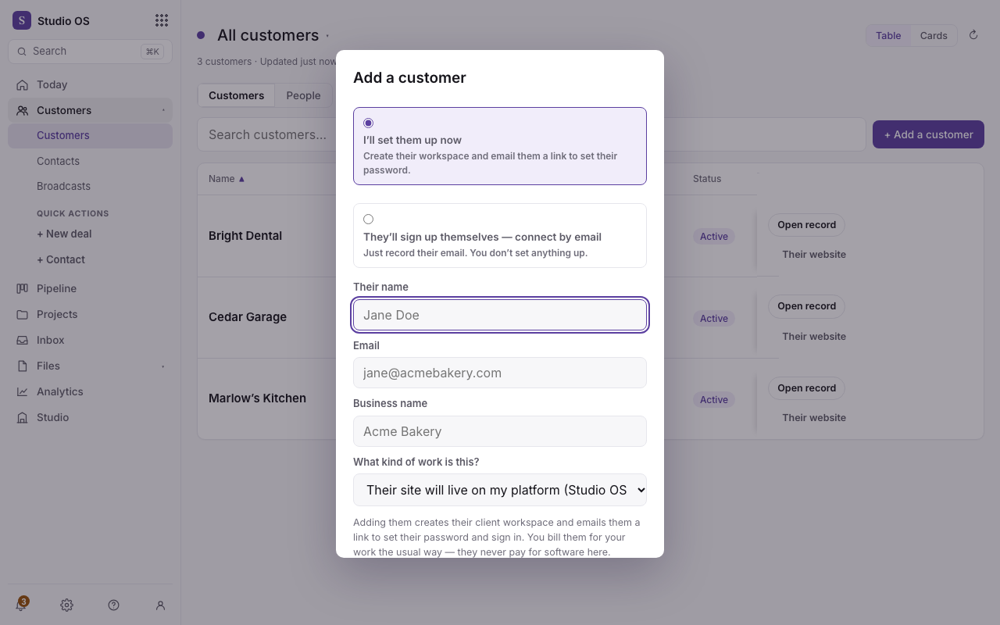 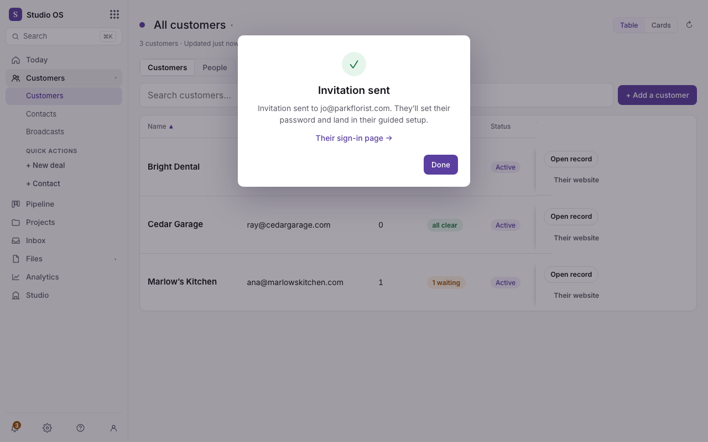

**1b · From a won deal:** Pipeline → the deal → **Billing** → **Convert — set up their workspace** → **Yes, add them as my customer** (5 clicks). This path seeds the project, emails the portal invite and leaves three doors behind: *Open their project →*, *Manage their access →* and *Resend welcome email*. *Manage their access →* links to bare `/sharing.html` — the studio's own site (bug 1).

### 2 · Open a client's workspace: 1 click, and the way back is clear

**Steps:** the row's **Their website** → `presence.html?client=…`. The shell paints "Studio › Marlow's Kitchen" and a *Viewing client* card with five links. **Exit to Studio** is one click.

- **Works:** the scope is in the URL, the header goes out on every request, the server checks the agency membership, the role (owner, admin or account manager), that the site is an active client, and audits the request. Every nav, bell and ⌘K link carries the scope. The builder shows one filled button.
- **Switch client goes to the other roster.** The card's *Switch client* opens `customers.html` (the bridge roster), not `agency.html` (the portfolio). An operator whose agency owns no site of its own gets a 404 there and sees "We couldn't load your customers just now" (bug 5).
- **The primary bar grows to 14 items** once scoped (the client's Website group opens inside it).

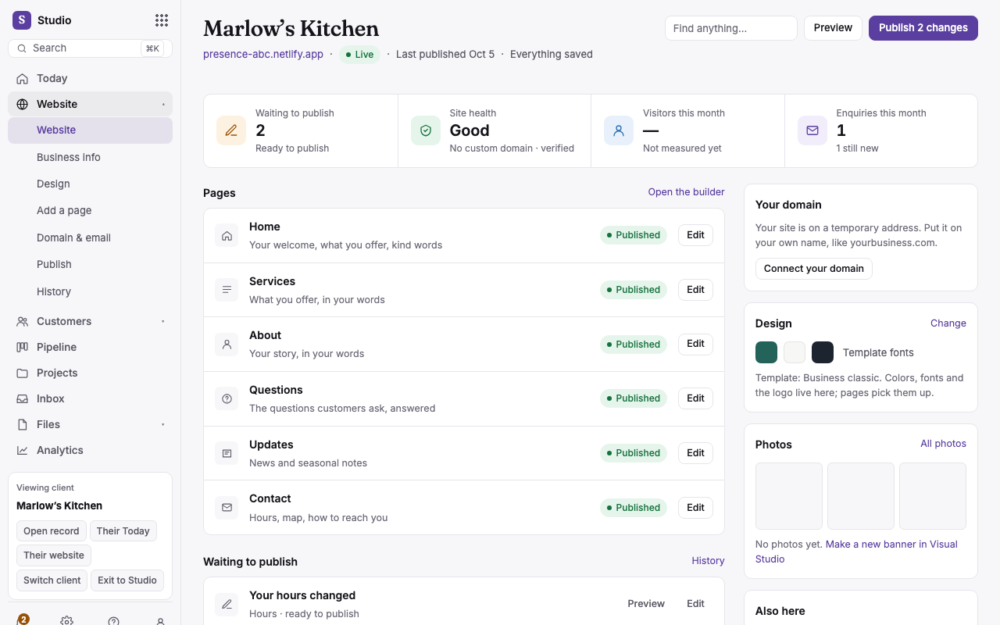 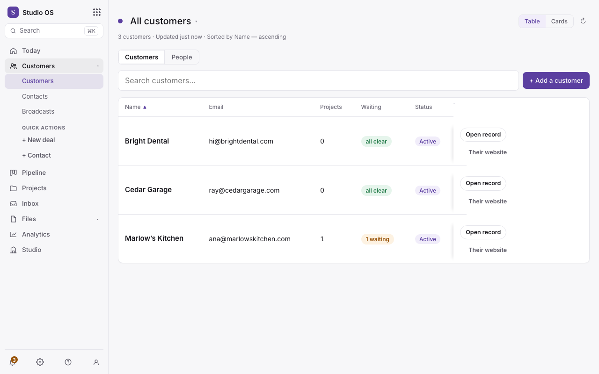

### 3 · Publish a change for a client: 4 clicks, in the client's voice

**Steps:** **Their website** → **Business info** (the Website section is already open) → type the tagline → **Publish · 2** → **Publish these 2 changes**.

The ritual is the owner's ritual, word for word: "Your hours changed", "Your live site stays as it is until the moment you decide", and the receipt "Every word on your site came from you." The client's name appears only in the context card on the left. Server-side, `publish.ts` records the actor as `client` unless the caller is platform staff, so the client's own room later reads "published by you". No notice or moment reaches the client when the studio publishes for them; the only client email is the one-time "Your website is live" on a bridged site's first publish.

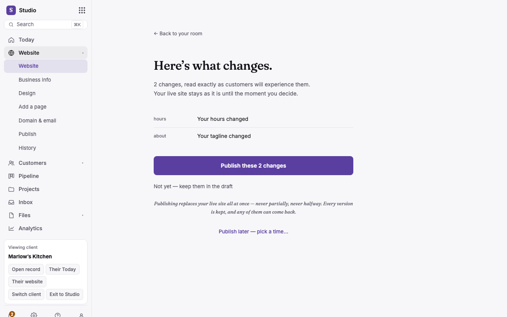

### 4 · Connect Search Console for a client: 4 clicks, the circle is closed, the voice is wrong

**Steps:** **Their website** → account menu → **Connections** (`?client=` carried) → **Connect** → Google → `connections-callback.html` → **Back to your connections** (`?client=` carried).

The walk confirmed both legs send the client's scope header, and the way out keeps `?client=`. The 2026 "circle" is fixed on `main`. Three things remain:

- **It is the operator's Google account that signs in.** The page says "Who owns it: you do. It's your account and your permission", written for the owner. The studio connects with its own Google login, which needs delegated access on the client's property — the same awkwardness every reporting tool has (section 5).
- **One pending slot.** `dds-pending-scope` is one `localStorage` key; two clients' connects in two tabs and the second comes back `bad_state`.
- **Settings → Connections drops the client.** The card carries `data-noscope`, lands on bare `connections.html`, and an operator with no site of their own sees "Open a client first" (walk 4b, bug 2). The audit log writes agency members as `customer`, not `operator`.

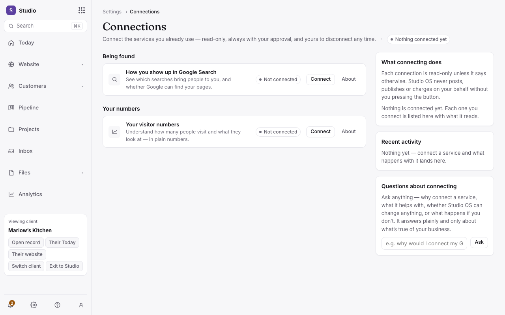 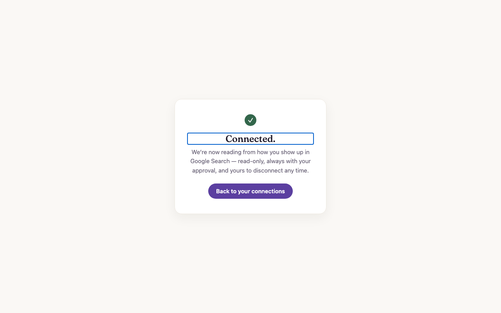

### 5 · Proposal, agreement, deposit: 7 clicks, three emails, five filled buttons

**Steps:** **Pipeline** → the deal → **Billing** → **Send to Ray Cedar →** (proposal) → **Send to Ray Cedar for signature →** (agreement) → **Request a deposit** → amount → **Save**.

- The deal page is a full page with its own back bar; *Open customer record →* and *Mark Stage as Complete* are both filled before you start, and the Billing tab adds *Send to Ray Cedar →*, *Send … for signature →* and *Send the agreement for signature →* in the convert card below. **Five filled buttons at once** — the most of any screen in the three audits.
- Each send is its own email with its own link. PR #29 (open) makes it one link and one email. Sending the agreement already mints the deposit invoice when the text names a deposit — a good instinct the leaders share (Moxie).
- **Signing does not move the deal.** On signature the studio gets a notice ("Agreement signed — ready to convert") and the stage stays where it was; the leaders move the stage themselves on signature.
- The deposit's mini-form button is labelled **Save**, not *Request deposit*. The record's own form (job 7) labels it correctly.

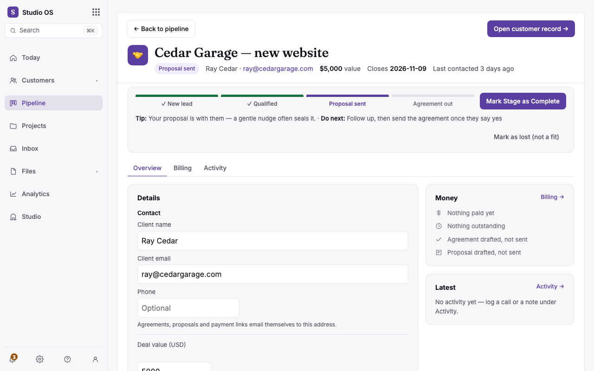 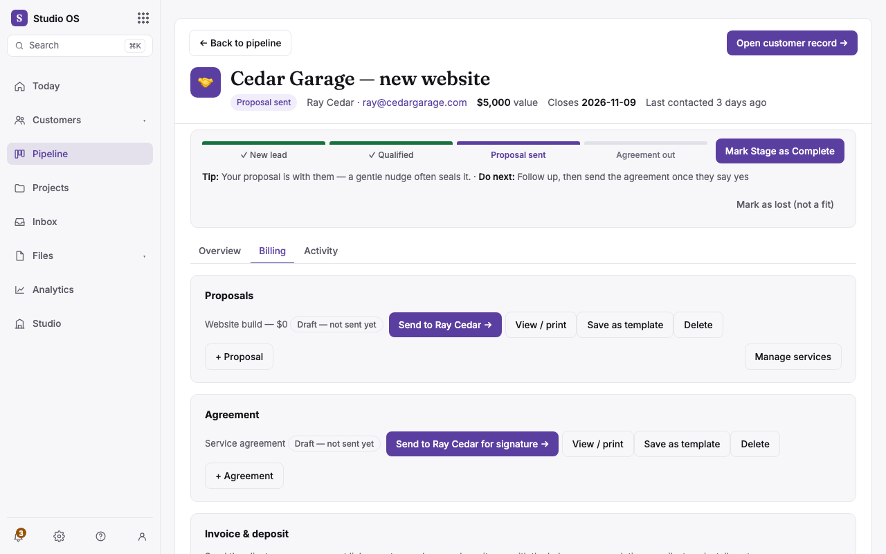

### 6 · Start a project and request an approval: 5 clicks, 3 fields

**Steps:** **Projects** → **+ New project** → name, (customer), template *Website build* → **Create project** → **+ Request** → "What needs approval?" → **Save**.

- The dialog's customer list comes from converted deals; with none converted it offers only "Just my studio (internal)". A project made here gets the four-milestone *Website build* template; one made by *Convert* gets the ten-step checklist instead — two templates, two doors.
- **+ Request** is quick and the client gets "Needs your OK — Homepage design" by email, then *Approve / Request changes* in their portal (the thing the October benchmark called ahead of every portal tool). But the request is always `subject_type: project`: you cannot ask for approval *of* the mockup you just shared, and sharing a deliverable (**+ Share**) emails nobody. No reminder ever goes out; Basecamp reminds the day before and daily after.
- The record shows two filled buttons (*Mark Milestone Complete*, the composer's *Send*).

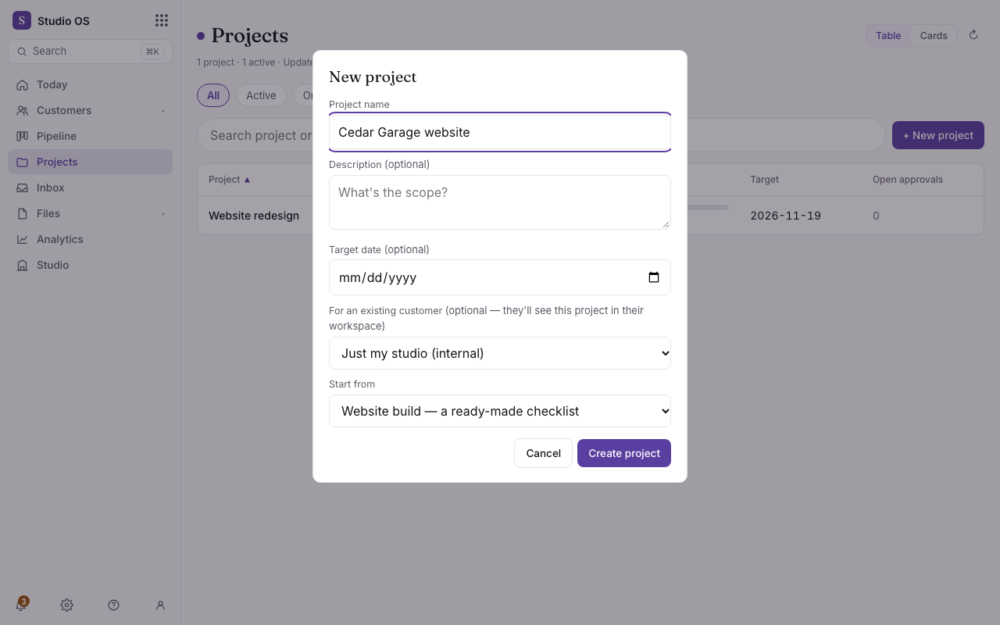 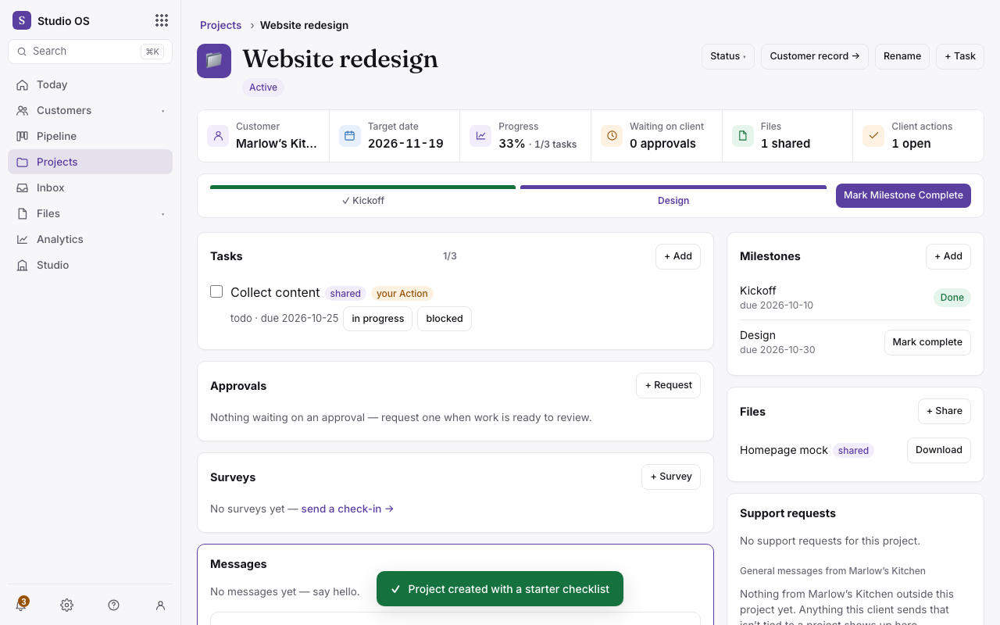

### 7 · Invoice a client, and see who owes you: 3 clicks, 2 fields

**Steps:** the row's **Open record** → **Send invoice** (the action bar's one filled verb) → amount, label → **Send invoice**.

The record is the right place and the form is inline. Three filled buttons share the screen (*Send invoice*, *Mark Stage as Complete*, the rail's *Send*), as the experience review (PR #27) already noted. The Billing tab's *Payment schedule* link points at `pipeline.html?deal=…#schedule`, and pipeline never reads that hash (bug 6).

**Who owes the studio:** Pipeline's *Outstanding* tile → *see who →* (2 clicks), or Today's money band ("$1,200 is due now … Who owes you"), which at studio level is the studio's own book. `agency.html`, the page the studio lands on, mentions no money at all: its roster has a *billing_issue* flag per client and nothing else.

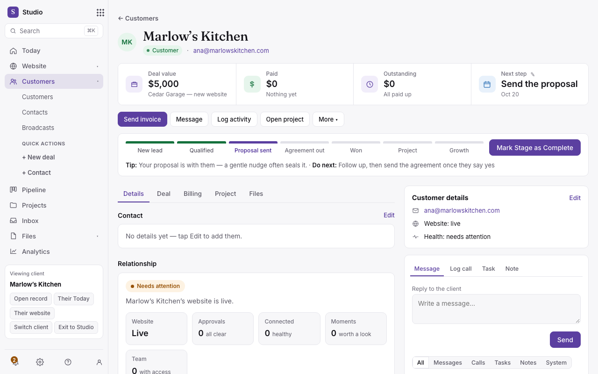 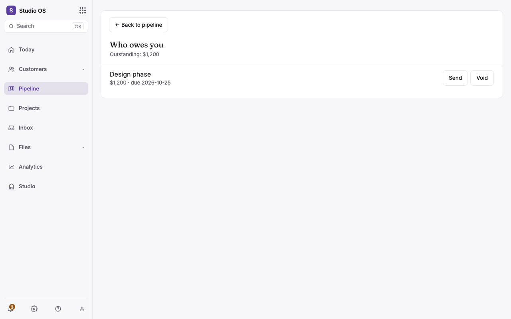

### 8 · Work the Inbox: 3 clicks to reply, 3 to resolve

**Steps:** **Inbox** → the client's thread → type → **Send**. For a support request: the row → type → **Reply and resolve**.

- One queue across every customer of the studio, rows named by client with a kind chip (Message · Support · Quote request), *All clients* and *All projects* filters, "3 conversations · 3 need you", ↑/↓ and Enter. A reply lands on the project's messages and the client's record. This is at or above the leaders (section 5).
- No assign, snooze or bulk actions; none of the studio tools have them either. The reply goes out through the platform's mailer in the studio's branding (17hats' model), not through the studio's own mailbox (everyone else's).
- The Inbox reads the bridged customers of *one* site (the studio's), which is every client the studio delivers for. A client's own enquiries and notices live in that client's Inbox (`?client=`), so a studio with ten clients has eleven inboxes for website enquiries.

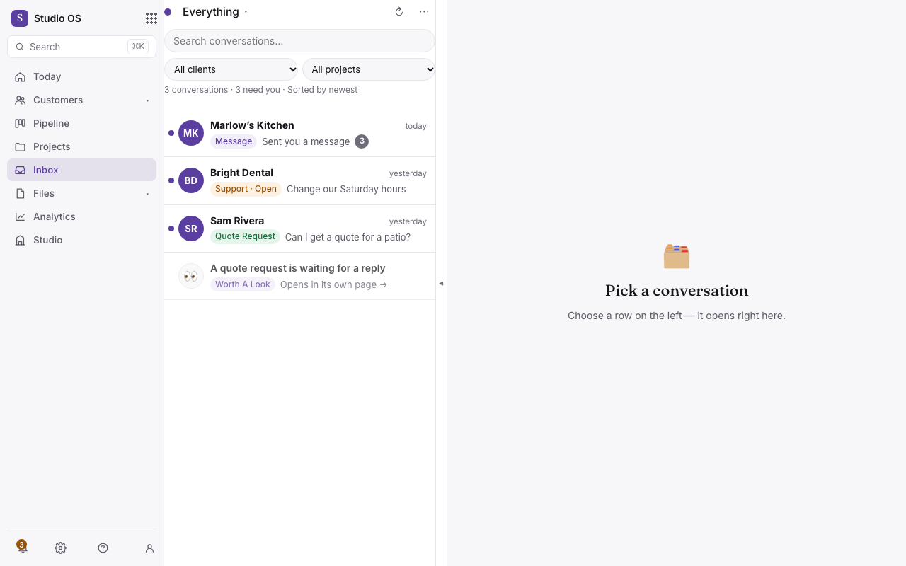 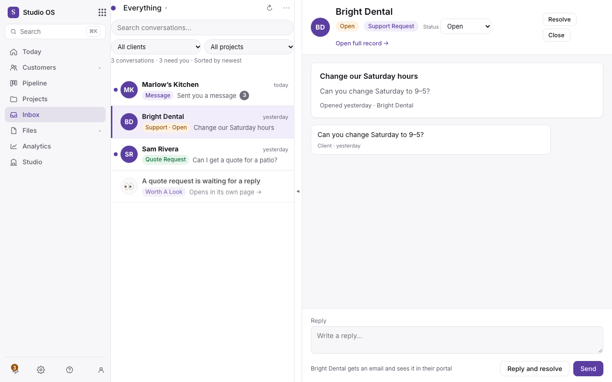

### 9 · Invite a client reviewer: 3 clicks, the wrong tenant

**Steps:** account menu → **Sharing & access** → email → **Send invite**.

From studio level the page is the studio's own site's sharing page (breadcrumb "Workspace › Sharing & access", people: the studio owner). The walk sent the invite and the `/portal/members` request carried **no scope header** — by design on this page. The reviewer is invited to *Bright Studio*. Scoped (walk 9b): the URL has `?client=`, the context card says "Viewing client Marlow's Kitchen", the page looks identical, and the request **still carries no scope**. The invite goes to whichever site the studio's JWT resolves to. There is no way, from this page, to invite a reviewer to a client's site (bug 1).

The role list has one option, *Reviewer (view only)*. Team members (the eight agency roles) have no page at all.

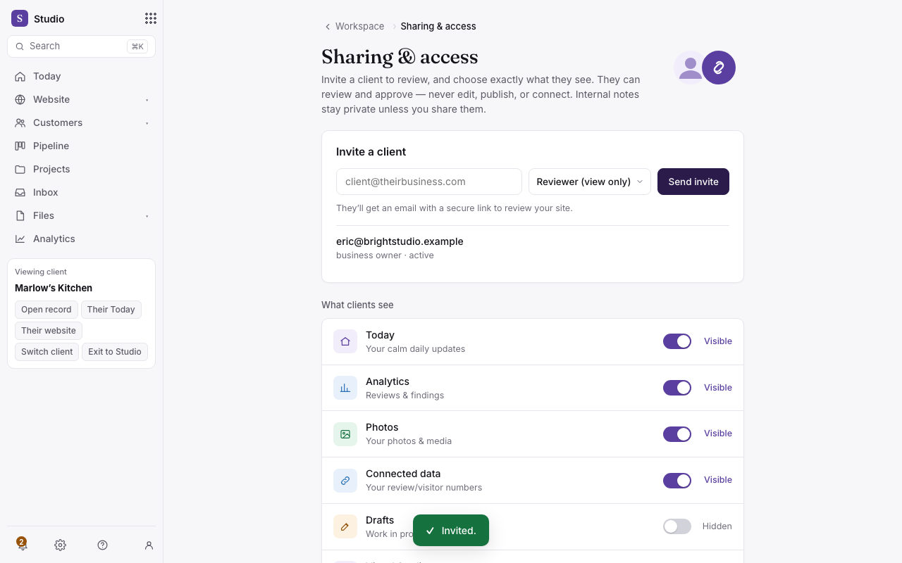

### 10 · Platform health and the studio's own plan

**Health:** one click, if you find it. The *Platform health — background jobs, errors, email posture →* link is mounted under the starter kits at y = 1064, only after a staff probe succeeds. The Health Center itself is good: ten areas, honest states, drill links (*Manage domains →*, *Open broadcasts →*, *Open Growth →*). Nobody in the benchmark has this page.

**Plan:** account menu → **Settings** → the *Plan & billing* card ("Agency · Active") → **`presence.html#business`**: the studio's own website builder, Business view, where a "Your plan & billing" card lives among the business facts. The Agency plan is not self-serve, so in production there is no *Manage billing* button, and the seat and client limits `/agency/me` returns are shown nowhere. Also in Settings: the *Connections* card's status never renders (it reads `data.services`; the API returns `data.groups`), and *Domains & email* opens `admin-health.html`, an operators-only page (PR #27 re-points it for non-operators).

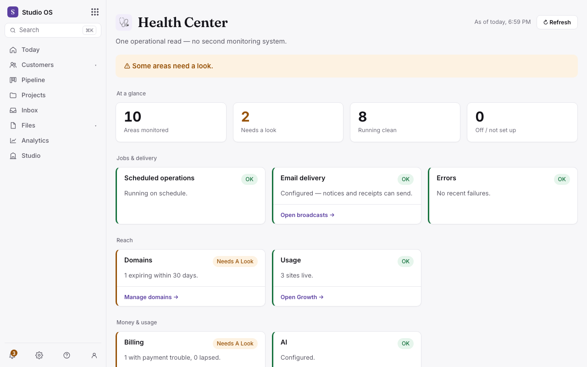 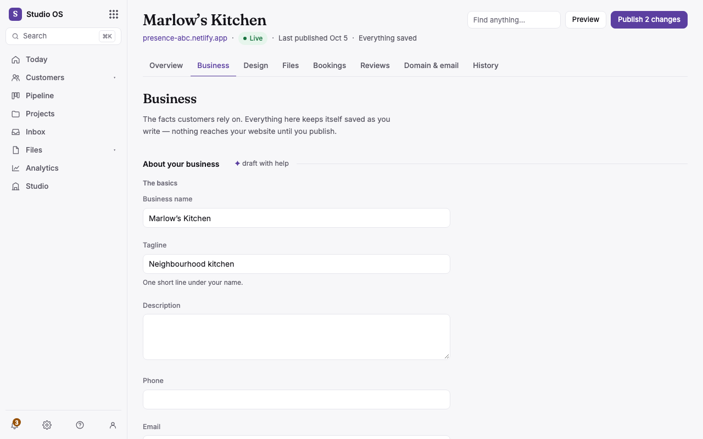

### Q · The queue, and K · a starter kit

*What needs you today* on `agency.html` is the best thing on the studio side: "High priority · 1 — Marlow's Kitchen — billing needs a look · 2 leads waiting →", one click to that client's Today with the context card ready. No vendor in the benchmark has a cross-client queue. The `patterns` the endpoint returns are never rendered.

The kit card sits under the roster (y = 407 with three clients; lower with thirty). *Apply a kit… → …to client → Apply* is one click and two pickers, with an outlined button.

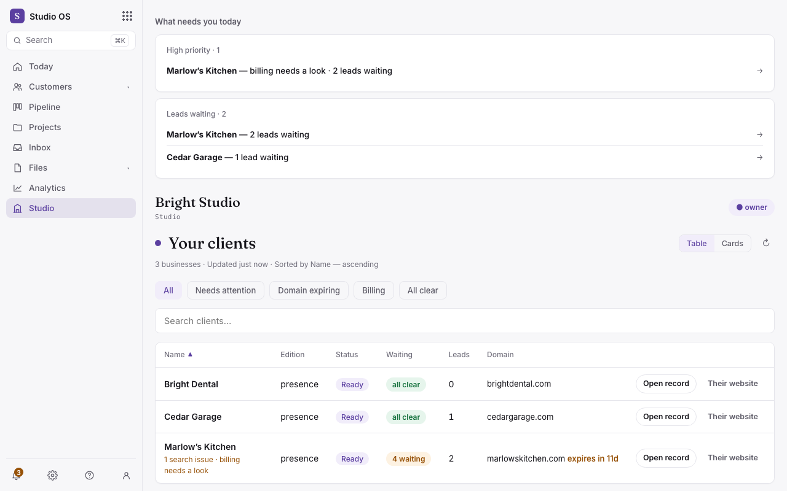 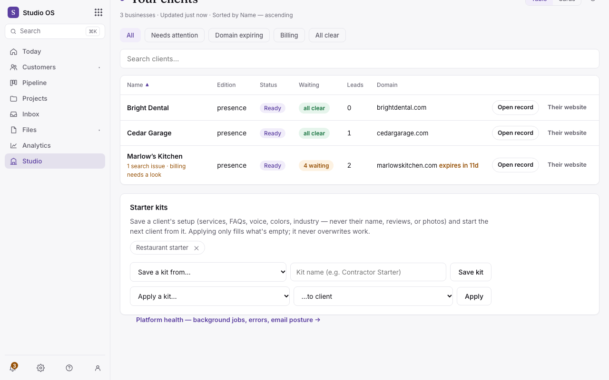

---

## 4. Duplicates and wrong doors: stay, fold in, or go

Same rule as the October audit: a page earns its place only if it shows something no home shows, for a job someone does on purpose.

| Surface | Verdict | Why (one sentence) |
| --- | --- | --- |
| `today.html` at studio level vs `agency.html` | **One home.** Fold Today's money tiles, *This week* and *Key deals* into `agency.html` under the queues, and drop *Today* from the agency's primary bar (it stays for a drilled-in client as *Their Today*). | Two landing pages for one person; the one the studio lands on shows no money and the one with money is one click away and looks like a client's. |
| `customers.html` vs `agency.html`'s roster | **One roster, on the home.** `agency.html` already has the richer table (waiting, leads, domain and expiry, billing) one click from everything; the bridge list's columns (email, support waiting, projects) fold into its rows, a bridged-only customer still gets a row, and `customers.html` forwards an agency member there. *Switch client* then has one target. | Two tables of the same clients from two tables (`presence_agency_clients` and `presence_service_links`) that can disagree, with different actions on the same row. Moving the table the other way would cost the drill-in a click. |
| `analytics.html` portfolio lens | **Stay, as Analytics' home for agencies**, but take its *Clients · Needs attention · Enquiries waiting* tiles off (they are `agency.html`'s) and keep *Sites live* and visitors. | The client-by-client table is the only place the studio sees visitors per client; the rest repeats the roster. |
| `settings.html` *Plan & billing* → `presence.html#business` | **Billing lives in Settings.** The card becomes the plan: name, status, renewal, seats and clients used of the limit, and "Changes go through our team" with a contact. | The studio's subscription has nothing to do with its own website's business facts, and a drilled-in operator can never reach it from there. |
| `settings.html` *Domains & email* → `admin-health.html` | **Re-point** to the domain desk of the site in scope (PR #27 does this for non-operators). | Settings should never open an operators-only wall. |
| `admin-health.html` | **Stay**, with a status line on `agency.html`'s header as its door instead of a link under the kits. | Unique, and ahead of the market. |
| `admin-growth.html` | **Stay** as is, operator-only; note the second sign-in. | Legacy `clever-api`, its own session; folding its "what needs me" into the Health Center is a week nobody needs yet. |
| `provision.html` | **Go** from the deployed site (move to `docs/runbooks/`). | Unlinked, unauthenticated, and generates secrets-bearing packs. |
| Team invites, client tags/notes/archive, branding | **Add the doors.** A *Team* card on Settings over `/agency/members`; tags, notes and archive on the roster row over `/agency/clients/:id`. | The routes and roles exist; only pages are missing. |

Net: **−1 page** (`provision.html`), **−1 menu destination** (*Today* at studio level), one home, one roster.

---

## 5. Benchmark: the studio's seat against the market

The same products as [BENCHMARK-2026-10.md](BENCHMARK-2026-10.md): HoneyBook, Dubsado, Bonsai, Moxie, 17hats, Basecamp, Productive for the agency tools; HubSpot, Pipedrive, Attio for agency-side CRM; plus Duda, Wix Studio and AgencyAnalytics where an agency website platform is the better comparison. "Leaders" is the converged pattern from [research/studio-benchmark-2026-10.md](research/studio-benchmark-2026-10.md); "Studio OS" is what the code and the walks show on `main`. Verdicts as before: **Ahead**, **At par**, **Behind** (with the fix named), **Skip** (said so deliberately).

| Job | Leaders | Studio OS | Verdict |
| --- | --- | --- | --- |
| **1 · Onboard a client from zero** | One form creates the contact and the project together (Dubsado needs title, contact, status; Bonsai only a company name; HoneyBook 3 clicks). The portal is passwordless (magic link, code or tokenized link), starts off and is switched on by the owner; nothing is seeded. Website platforms go site → client account → per-site grant, with a set-password URL valid 30 days (Duda) or a 30-day invite (Wix Studio). | One dialog, 5 clicks, 3 fields: account, hosted site, project with a checklist, portfolio link, portal invite. Set-password link. No kit applied, nothing published. Not offered on the home page; ⌘K blind to "client". | **Ahead** on what one form does (no leader provisions a site). **Behind** on findability, on the password (a magic link, as the reviewer invite already uses) and on the copy that promises a guided setup (change 4). |
| **2 · The roster and the cross-client queue** | A table with pickable columns, chips, one-column sort, saved views (HoneyBook 5, Moxie personal views), thin bulk (Dubsado archive/status/delete; HoneyBook none). No vendor has a cross-client "needs me" queue; the nearest are HoneyBook's overdue-task indicator and AgencyAnalytics' disconnected-integrations board. Wix Studio surfaces renewals and payment problems. | *What needs you today* (queues with one-click drill-in) plus a roster with waiting, leads, domain expiry and billing flags, five chips, sort and search. Two rosters. No tags, notes, assignee or archive in the UI (the routes exist). No money column. | **Ahead** on the queue. **Behind** on one roster (change 3) and on the missing tags/archive doors (change 6). |
| **3 · Acting for a client** | A read-only "preview as client" (HoneyBook, Bonsai 4 clicks); a real impersonated tab only in Moxie; Dubsado previews the login page. HubSpot's partner access is client-approved, seat-free, blocked from billing and super-admins, audited, and expires 60 days after the last activity. Duda and Wix Studio: the agency simply is the account. | A real operator session: scope in the URL and header, server-validated (membership, role, active client), **every scoped request audited**, a context card with five exits. But the product speaks as the client ("your site", "came from you", "published by you"), the client is never told the studio acted, and the audit records the agency member as `customer`. | **Ahead** on the model. **Behind** on voice, attribution and the client's view of it (change 2). The client-consent step (HubSpot) is a **skip** for a studio whose clients it provisions. |
| **4 · Connect Google for a client** | Nobody emails the client a "connect your Google" link natively. The agency's own login with delegated permissions (AgencyAnalytics Analyst+, Semrush Viewer+), or a client user who connects themselves; "send a link, the client approves in Google" lives in AgencyAccess, Leadsie and Wix's connection API. Duda and Wix: paste an ID. | The operator connects with their own Google account in the client's scope; the scope survives the OAuth round trip; honest 503s name the exact secrets and redirect URI. Owner-voiced copy; one pending slot. | **At par** (the market is equally awkward). The ahead move is a signed "connect your Google" link the client opens from their portal (change 9). |
| **5 · Proposal → agreement → deposit, from the seller's seat** | One document the client walks through in order (HoneyBook, Dubsado, 17hats, Moxie); Bonsai a 3-document chain with auto-invoice on accept. Stage moves itself on signature (HoneyBook, Dubsado, HubSpot). Moxie mints the deposit from the agreement. Reminders: 17hats −1d/+1d/monthly; Pipedrive manual, 60-day expiry. | Three sends, three emails, 7 clicks; the agreement send mints the deposit when the text names one; signature raises a notice but the stage stays; one reminder, once, after 3–21 days. Five filled buttons on the Billing tab. | **Behind** on one link (PR #29 closes it) and on the stage moving on signature (change 7). **At par** on the deposit mint and reminders. |
| **6 · Projects and approvals** | Project from a won deal (Productive 4 options, Pipedrive "mark as won and create a project") or a template. A true client approve/decline on a deliverable only in Basecamp (no login, reminders 24h before then daily, receipt to the firm) and Moxie (an approval status column with a reminder cadence); comments-only elsewhere. | Convert creates the project with a ten-step checklist; *New project* offers a four-milestone template. *+ Request* emails "Needs your OK" and the client approves in the portal — but always project-level, sharing a file emails nobody, and no reminder ever fires. | **Ahead** on having approvals at all (as before). **Behind** on per-deliverable requests and reminders (change 8). |
| **7 · Money across clients** | Four buckets on the home screen (HoneyBook Paid/Processing/Upcoming/Overdue; Bonsai Outstanding/Overdue/Pending/Paid); per-client balance; reminders on by default, three of them (HoneyBook −7/0/+2; Bonsai four); Productive adds profitability. Own plan: an owner-only billing page that wraps Stripe. | Send invoice from the record in 3 clicks; Pipeline's *Outstanding* tile and *see who*; Today's band (PR #31 adds the four states); one gentle reminder, once. No money on the roster or on `agency.html`. The plan card points into the website builder; agency limits never shown. | **At par** on sending. **Behind** on money on the roster and reminder cadence (changes 3 and 10) and on where billing lives (change 5). |
| **8 · The inbox** | One list of threads across clients anchored to the project (HoneyBook, Dubsado 3.0, Moxie); reply, mark read, archive, attach-to-project; assign/comment/move only in HubSpot; keyboard almost nowhere (Attio's `c`). Sent through the owner's own mailbox; HubSpot's team email is the only shared studio address. | One queue, six views, client and project filters, kind chips, "N need you", ↑/↓ Enter, reply to the record, reply-and-resolve, saved replies. No assign, snooze, bulk. Sent by the platform's mailer in the studio's brand. | **At par**, **ahead** on keyboard and on support-request handling. Assign and snooze: **skip** for a one-person studio. |
| **9 · Access and invites** | A global team role plus per-project membership (HoneyBook 5 roles, Dubsado 3, Productive permission sets); clients never seats, start empty, widened per item (Basecamp); "preview as client" near-universal; who-saw-what logged only by the CRMs. White-label: logo, own mailbox, CNAME portal. | One reviewer role, eight share switches, resend and remove; **no team page** over the eight server roles; no preview (the operator can open the real thing instead); the scoped page writes to the wrong site. Email brand per site; `/agency/branding` has no page. | **Behind** on team seats and on the scope bug (changes 1 and 6). **At par** on share switches. Preview-as-client: **skip**, the operator session is the preview. |
| **10 · Health, admin, own plan** | No ops dashboard anywhere; inline icons, a feed and an email, "reconnect it yourself"; a public status page; AgencyAnalytics' integration-status board is the only cross-client health view. | The Health Center: ten areas, bands, drill links, honest "off". Reached by a text link under the kits. Billing: see job 7. | **Ahead** on the Health Center. **Behind** on its door and on billing's home (changes 5 and 11). |
| **The agency home** | A client list with health columns, and a "today" strip: HoneyBook (leads unanswered, unread, tasks, YTD bookings, this month's payments in four buckets), Productive (overdue invoices by client, utilization), Wix Studio (renewals, payment problems), 17hats (snoozable action items by type). | Queues plus roster on `agency.html`; money, this week and key deals on a second page. No unread count, no renewals strip (domain expiry is a column). | **At par**; one home would be **ahead** (change 3). Utilization: **skip**. |

### Where the studio side is ahead

1. **One form provisions everything.** Account, hosted site, project, portal and invite. No competitor does this.
2. **A cross-client queue with one-click drill-in.** Nobody in the benchmark has *What needs you today*.
3. **A real, audited operator session.** Scope validated server-side on every request and logged; the leaders offer read-only previews or a client-approved seat.
4. **A Health Center.** Ten operational areas in plain words, with drill links. The leaders have status pages.
5. **Approvals the client can decide in their portal**, requested in two clicks (still the only portal with this as a first-class object).
6. **An Inbox with keyboard, kind chips and reply-and-resolve.**

---

## 6. The changes, ranked for approval

Ranked by how much it fixes for the studio for the effort. S = a day, M = a few days, L = a week or more. None of them is started.

| Rank | Change | Effort | Touches |
| --- | --- | --- | --- |
| **1** | **Sharing & access sends the scope, and every post-convert "access" link carries the client.** `sharing.html` sends `x-dds-scope-site` like every other page; its header says whose site ("Sharing & access — Marlow's Kitchen"); pipeline's *Manage their access →* becomes `/sharing.html?client=<site>`. Stops inviting reviewers to the studio's own site. | **S** | `sharing.html`, `pipeline.html`, sharing.spec |
| **2** | **Speak as the studio when acting for a client.** The ritual reads "Marlow's Kitchen's hours changed" and "Publishing their site"; the receipt drops "every word came from you"; `publish.ts` records `actor_kind: 'operator'` for agency members (and the connection audit does the same), so the client's room says "published by your studio"; a client notice on an operator publish. Connections copy loses "Who owns it: you do" while scoped. | **S/M** | `presence.html` ritual copy, `routes/publish.ts`, `routes/room.ts`, `routes/connections.ts`, `connections.html`, `lib/notice.ts` |
| **3** | **One home, one roster.** `agency.html` gains Today's money tiles, *This week* and *Key deals* under the queues; *Today* leaves the agency's primary bar and *Customers* opens `agency.html`. The portfolio table becomes the one roster: the bridge list's columns (email, support waiting, projects) fold into its rows, a bridged-only customer still gets a row, and `customers.html` forwards an agency member there; *Switch client* and `landingFor` agree. *+ Add a customer* and the Health Center's status line move into the top row (changes 4 and 11 in part). | **M** | `agency.html`, `customers.html`, `lib/navigation.ts`, `shell.js` context bar, agency/rosters/shell specs, three Deno nav pins. **Built: PR #34 (Oct 20).** |
| **4** | **Onboarding on the home page, honest copy, and a magic link.** *+ Add a client* on `agency.html` (and in its empty state), a ⌘K entry ("Add a client", desc "…their workspace, site and invitation"), a *Start from kit* picker in the dialog, the success line matching the link ("they'll land in their portal"), the pricing box only for *connect* mode, and the invitation as a magic link with a password offered later. | **S/M** | `agency.html`, `customers.html`, `contacts.html`, `lib/navigation.ts`, `routes/sales.ts` `sendCustomerInvite` |
| **5** | **Settings owns the studio's plan, and keeps the scope straight.** The *Plan & billing* card becomes the plan inline (name, status, renewal, seats and clients used of the limit from `/agency/me`, "changes go through our team"); the dead *Connections* status reads `groups`; *Domains & email* opens the domain desk of the site in scope; while scoped the page says "Settings for Marlow's Kitchen" and the profile form is labelled theirs, or the studio's cards go away. | **S** | `settings.html`, settings.spec |
| **6** | **The doors that are missing: team and client housekeeping.** A *Team* card on Settings over `/agency/members` (invite, role, remove); tags, notes, assignee and archive on the roster row over `PATCH /agency/clients/:id`; the portfolio's search and archived filters wired. | **M** | `settings.html` (new card), `customers.html` / `agency.html` rows, agency/routes already exist |
| **7** | **Signature moves the deal, and the deal page calms down.** On a signed agreement the stage advances to *Won* (or *Agreement out* → *Won* on deposit paid) with the "ready to convert" notice kept; the Billing tab keeps one filled send at a time (the next one in order) and the back bar's *Open customer record →* goes quiet. PR #29 supplies the one link. | **S** | `routes/sales.ts` sign handler, `lib/sales_lifecycle.ts`, `pipeline.html` |
| **8** | **Approval per deliverable, with reminders.** *Request approval* on a deliverable row (`subject_type: 'deliverable'`), sharing a file offers "ask them to approve it", and a lifecycle job reminds the client the day before the due date and daily after (Basecamp's cadence, at most once a day). | **M** | `projects.html`, `routes/project_delivery.ts`, `commerce/lifecycle.ts` |
| **9** | **"Ask the client to connect their Google."** A signed link, emailed from the scoped Connections page, that opens Connections in the client's portal so the *client's* Google account authorises Search Console and Analytics. Keeps the operator path as the fallback. One pending-scope slot per client while here. | **M** | `connections.html`, `client.html`, `routes/connections.ts`, `connected/auth.ts` |
| **10** | **Money on the roster and three reminders.** An *Outstanding* column and chip on the one roster (from `/sales/receivables` by customer); invoice reminders −7 / due / +2 days, at most once a day, as the switch the October benchmark's item 6 proposes. | **S/M** | roster page, `commerce/lifecycle.ts`, `settings.html` |
| **11** | **The Health Center's door.** A one-line status on `agency.html`'s header ("Platform: 2 areas need a look →") for staff, instead of a text link under the kits; ⌘K "health" finds it. | **S** | `agency.html`, `lib/navigation.ts` |
| **12** | **Tidy the edges.** `provision.html` leaves the deployed site; the record's *Payment schedule* link opens the schedule builder (pipeline reads `#schedule`); the deposit mini-form's button says *Request deposit*; the Inbox's enquiry view can show a client's enquiries when a client filter is picked (`?client_id=` already exists). | **S** | `_redirects`, `crm.html`, `pipeline.html`, `inbox.html` |

**If the first six ship:** one home and one roster (−1 page, −1 menu destination, two rosters → one), no wrong-tenant writes, a product that names the client when the studio acts, a team page, and onboarding that is findable and tells the truth. Jobs 1, 2, 9 and 10 each lose a click or a wrong turn; nothing in this audit would take more than five clicks.

**Deliberately skipped:** preview-as-client (the operator session is the real thing), client-approved partner access with expiry (the studio provisions its clients), assign and snooze in the Inbox, utilization, white-label dashboards on the studio's domain, and folding `admin-growth.html` into the Health Center.

### Bugs found while walking

Not part of the ranking; each is cheap and worth its own small PR, and the first three are wrong-tenant risks.

1. **Sharing & access never sends the scope header** (`sharing.html` builds its own headers without `x-dds-scope-site`). Scoped or not, *Send invite*, *Resend*, *Remove* and the eight share switches act on the site the JWT resolves to — the studio's own. The page still paints the "Viewing client" card. Walk 9b: `members/shares calls carried scope header: ["(absent)"]`. Pipeline's post-convert *Manage their access →* links to bare `/sharing.html`.
2. **Settings while scoped is half the client's, half the studio's.** The *Studio profile* form reads and writes `/identity` **with** the scope header (the client's name, email and area under the heading "Studio profile"); *Team & access*, *Connections*, *Domains & email* and *Developer* carry `data-noscope` and leave the client silently; *Connections* then lands an operator with no site of their own on "Open a client first". Only *Plan & billing* hides.
3. **`contacts.html` sends the scope header and carries the *Add a customer* dialog.** Drilled in, its guard only shows when the scoped contact list is empty; otherwise *Set up + invite* runs `POST /sales/customers` against the client's site. From the code; not reproduced at runtime.
4. **The operator's publish is recorded as the client's.** `routes/publish.ts` writes `actor_kind: 'client'` for anyone who is not platform staff, so an agency member's publish reads "published by you" in the client's room, and the connections audit writes `customer`. No client notice on an operator publish.
5. **Two rosters that can disagree.** `agency.html` reads `presence_agency_clients`; `customers.html` reads `presence_service_links`. The portfolio link in *Add a customer* is best-effort: when it fails and the bridge succeeds, the client is on Customers but not on Studio, and the drill-in is refused; the reverse leaves them on Studio only. *Switch client* goes to Customers, which 404s for an operator whose agency has no site of its own ("We couldn't load your customers just now").
6. **Record → *Payment schedule* goes nowhere useful.** `crm.html` links `pipeline.html?deal=…#schedule`; pipeline never reads a hash, so it lands on the deal's Overview.
7. **Settings' *Connections* card status never renders** (`data.services` vs the API's `data.groups`), and *Domains & email* opens the operators-only Health Center for everyone with a website (PR #27 fixes the latter for non-operators).
8. **Onboarding copy.** "They'll set their password and land in their guided setup" (the link is the client portal); the *Set up + invite* dialog shows a pricing box telling the client to pay for a plan it then provisions for free.
9. **Screens with more than one filled button:** the deal page (2, then 5 on Billing), the record with a deal (3), the project record (2), Sharing & access (the switches read as filled). `agency.html` itself has **no** filled button.
10. **Small:** `/agency/queues` returns `patterns` the page never renders; the deposit mini-form's button says *Save*; `provision.html` is deployed, unlinked and unauthenticated; ⌘K "billing" returns *Customers* (its desc contains the word) and nothing for "plan", "health", "team", "kit" or "client".

---

## Appendix: how to re-run the walks

```bash
npx playwright test -c docs/design/audit/studio/walks/playwright.walks.config.ts
```

- The config serves the repo on port **4196** (the October walks use 4198; WebKit refuses 4190) with `reuseExistingServer: false`, blocks service workers and pins UTC. Desktop Chromium only.
- Screenshots go to `docs/design/audit/studio/` (`AUDIT_SHOTS`) and the step log to `docs/design/audit/studio/walks.jsonl` (`AUDIT_LOG`).
- `walks/fixtures.ts` holds the agency persona: `AGENCY_NAV` copied from `buildNav` for an agency member at studio level, `SCOPED_CTX` for a drilled-in client, a three-client portfolio, and the sales, project, inbox and connections payloads in the shapes the specs use. `walks/studio.ts` answers `/portal/context` by the scope header, the way the server does.
- The walks reuse `docs/design/audit/walks/walk.ts` (the click counter) and `probe.ts` (the filled-button probe).
- Nothing under `docs/` is part of the e2e suite or the deployed site.
